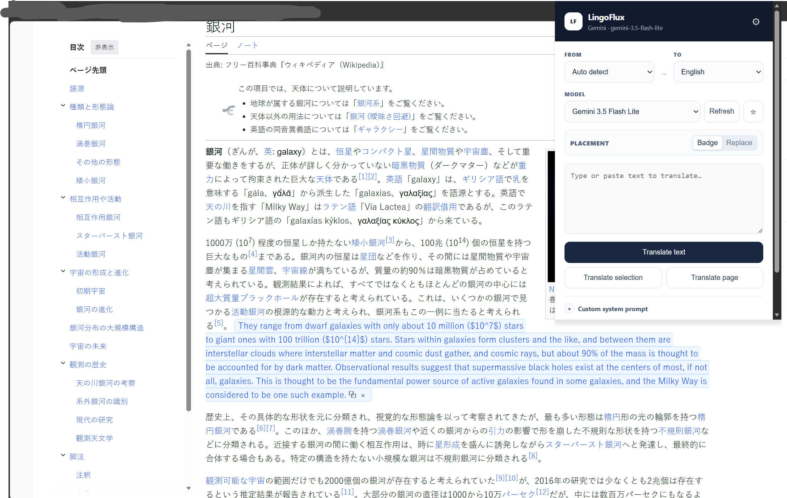
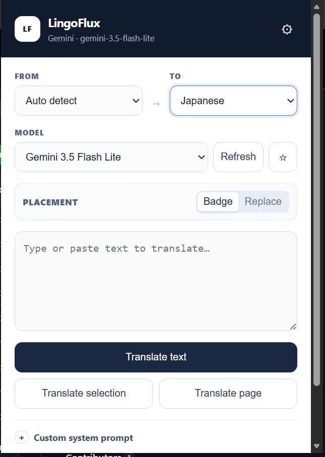
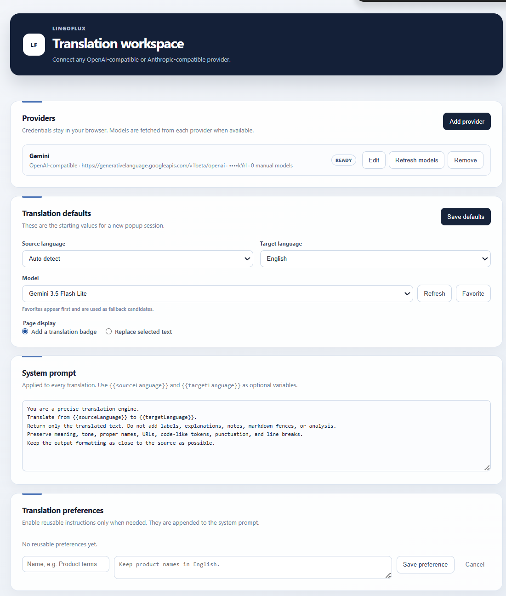

<p align="center">
  
</p>

<h1 align="center">LingoFlux Translator</h1>

<p align="center">
  A privacy-conscious, bring-your-own-provider translation extension for Chrome and Microsoft Edge.
</p>

<p align="center">
  <a href="https://github.com/xuanquangIT/AI-Translate-Extension/actions/workflows/ci.yml"></a>
  <a href="https://github.com/xuanquangIT/AI-Translate-Extension/releases/latest"></a>
  <a href="LICENSE"></a>
  
</p>

LingoFlux translates selected text, pasted text, or an entire page through an OpenAI-compatible or Anthropic-compatible API endpoint configured by the user. It has no LingoFlux account, hosted translation backend, advertising, or developer-controlled analytics.

> Release status: LingoFlux is available as a public beta from GitHub Releases. Chrome Web Store and Microsoft Edge Add-ons listings are not live yet.

## Download

Download the latest verified package and checksum from [GitHub Releases](https://github.com/xuanquangIT/AI-Translate-Extension/releases/latest).

1. Download `lingoflux-v1.3.0.zip` and extract it.
2. Open `chrome://extensions/` or `edge://extensions/`.
3. Enable **Developer mode**, choose **Load unpacked**, and select the extracted directory.
4. Open **Settings** and configure your own compatible provider endpoint and scoped API key.

The archive is for unpacked installation until official browser-store listings are published. Compare its SHA-256 value with the checksum attached to the release before installing.

## Product tour

### Translate in context



### Focused popup and provider workspace

<table>
  <tr>
    <td width="45%"></td>
    <td width="55%"></td>
  </tr>
</table>

## What it does

- Translate a selection with the floating action, context menu, popup, or the `T` key.
- Display a translation in a non-destructive badge or replace the selection with a restore action.
- Translate visible webpage text while excluding forms, code blocks, hidden content, and LingoFlux UI.
- Connect multiple named OpenAI-compatible or Anthropic-compatible provider profiles.
- Discover models from `/models` or use manually entered model IDs.
- Prefer favorite models as fallbacks when the selected model fails.
- Apply a persistent system prompt and optional reusable translation preferences.
- Treat questions, commands, and prompt-injection text as content to translate, with strict translation-only provider output parsing.
- Keep selection and page jobs in the background when the popup closes.

## Trust and privacy at a glance

| Question                                     | Answer                                                                                                                                                           |
| -------------------------------------------- | ---------------------------------------------------------------------------------------------------------------------------------------------------------------- |
| Does LingoFlux operate a translation server? | No. Requests go directly from the extension to the provider endpoint you configure.                                                                              |
| Is there telemetry or advertising?           | No developer-controlled analytics, telemetry, advertising, or tracking is present.                                                                               |
| Where are credentials stored?                | In `chrome.storage.local` in the current browser profile. Browser local storage is not a password vault; use a scoped provider key.                              |
| What leaves the browser?                     | When you request a translation or model refresh, the relevant text, prompt/settings, model request, and provider credential are sent to the configured endpoint. |
| Why does it request access to webpages?      | To read user-selected or requested page text and insert the translation. LingoFlux does not translate in the background without a user action.                   |

Read the full [privacy policy](PRIVACY.md), [security policy](SECURITY.md), and [runtime architecture](docs/ARCHITECTURE.md) before using the extension with sensitive content.

## Install from source

Prerequisites: Node.js 22 or newer and npm.

```bash
git clone https://github.com/xuanquangIT/AI-Translate-Extension.git
cd AI-Translate-Extension
npm ci
npm run verify
```

Then:

1. Open `chrome://extensions/` or `edge://extensions/`.
2. Enable **Developer mode**.
3. Choose **Load unpacked**.
4. Select the generated `dist` directory.

For active development, you may load `src` directly and reload the extension after each change. The release artifact is always generated from `src`.

## Configure a provider

Open **Settings**, then create a provider profile:

| Compatibility        | Typical base URL             | Translation endpoint |
| -------------------- | ---------------------------- | -------------------- |
| OpenAI-compatible    | `https://api.example.com/v1` | `/chat/completions`  |
| Anthropic-compatible | `https://api.example.com/v1` | `/messages`          |

Add a scoped API key and either refresh the model catalog or enter manual model IDs. Provider compatibility varies; LingoFlux expects the request and response contracts documented in [Runtime Contracts](docs/CONTRACTS.md).

Use HTTPS endpoints for remote providers. The endpoint operator controls its own retention, logging, and data-processing practices.

## Use LingoFlux

### Selected text

1. Select text on a normal webpage.
2. Press `T`, use the floating action, choose the context-menu item, or click **Translate selection** in the popup.
3. The result appears as a badge or replaces the selection, depending on the configured display mode.

The `T` shortcut is ignored while typing in editable fields and when modifier, repeat, or composition events are active.

### Direct and full-page translation

- Paste text into the popup and choose **Translate text**.
- Choose **Translate page** to process eligible visible text segments in the current tab.

The persistent custom system prompt supports `{{sourceLanguage}}` and `{{targetLanguage}}`. Reusable preferences can be enabled or disabled independently in Settings.

## Browser support

| Browser                 | Project status                                                    |
| ----------------------- | ----------------------------------------------------------------- |
| Google Chrome 110+      | Primary release target                                            |
| Microsoft Edge 110+     | Primary release target                                            |
| Other Chromium browsers | Expected to work, but not part of the current release test matrix |
| Firefox                 | Not packaged or tested; no support claim is made                  |

See the [technical test matrix](docs/TESTING.md) for the browser paths that require manual verification.

## Development

```bash
npm ci             # reproducible dependency install
npm test           # credential-free unit + contract tests
npm run lint       # ESLint (npm run lint:fix and npm run format to auto-fix)
npm run verify     # syntax, extension validation, lint, format, tests, agent-config drift, build
npm run build:zip  # create the store/release ZIP
```

`npm run test:live` sends real requests to the provider configured by the `LIVE_*` variables in `.env` (see
`.env.example`) and consumes that key's quota. Run it only with a key you own; it is not part of CI.

### Project layout

```text
src/
  manifest.json      Manifest V3 metadata, permissions, and entry points
  shared/            Pure constants and helpers (config, languages, message registry, text)
  providers/         OpenAI- and Anthropic-compatible HTTP adapters
  translation/       Translation-only prompt policy and strict response parsing
  storage/           Settings, providers, favorites, instructions, history, migrations
  background/        Service worker: router, translation service, model catalog, tab jobs
  content/           Classic content script: selection and webpage DOM behavior
  pages/             Popup, options, and shared page helpers
  _locales/          Manifest localization
tests/               Unit and contract tests (node:test, chrome/fetch mocks)
scripts/             Build, validation, live smoke test, agent-config sync
docs/                Architecture map, contracts, playbook, testing, git and agent workflow, ADRs
.agents/             Canonical AI-agent rules, skills, and roles (mirrored to .claude/)
.github/             CI, CodeQL, release automation, and contribution templates
```

Contributor documentation:

- [Contributing guide](CONTRIBUTING.md)
- [AI agent guide](AGENTS.md) and [agent workflow](docs/AGENT_WORKFLOW.md)
- [Git workflow](docs/GIT_WORKFLOW.md)
- [Architecture](docs/ARCHITECTURE.md)
- [Runtime contracts](docs/CONTRACTS.md)
- [Feature playbook](docs/FEATURE_PLAYBOOK.md)
- [Testing](docs/TESTING.md)

## Contributing and support

Bug reports, focused feature proposals, documentation improvements, and pull requests are welcome. Please read [CONTRIBUTING.md](CONTRIBUTING.md) and use the repository templates so reports include enough evidence to reproduce and review.

- General help: [Support guide](SUPPORT.md)
- Bugs and proposals: [GitHub Issues](https://github.com/xuanquangIT/AI-Translate-Extension/issues)
- Vulnerabilities: follow [SECURITY.md](SECURITY.md); do not open a public issue

## License

LingoFlux Translator is available under the [MIT License](LICENSE).

Maintained by [@xuanquangIT](https://github.com/xuanquangIT).
